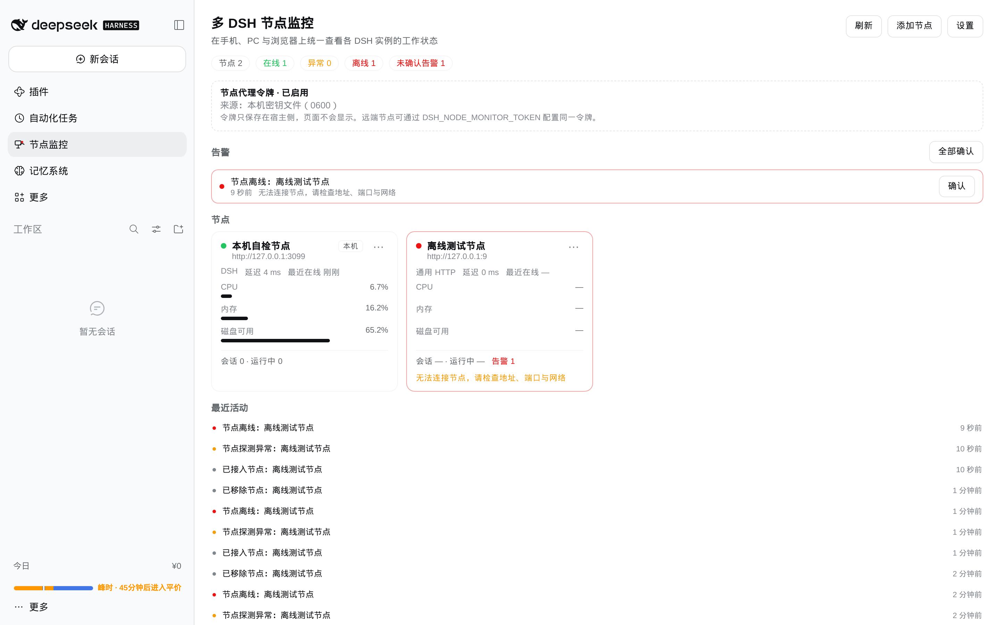
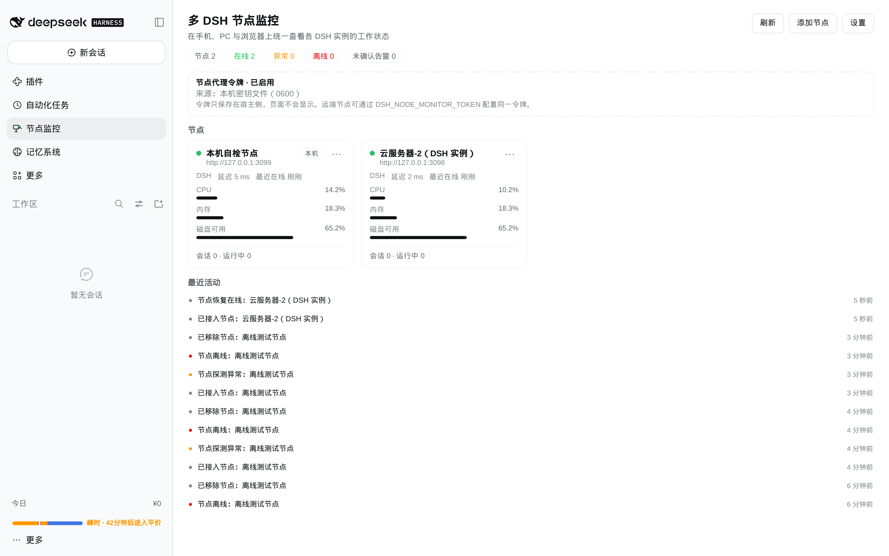
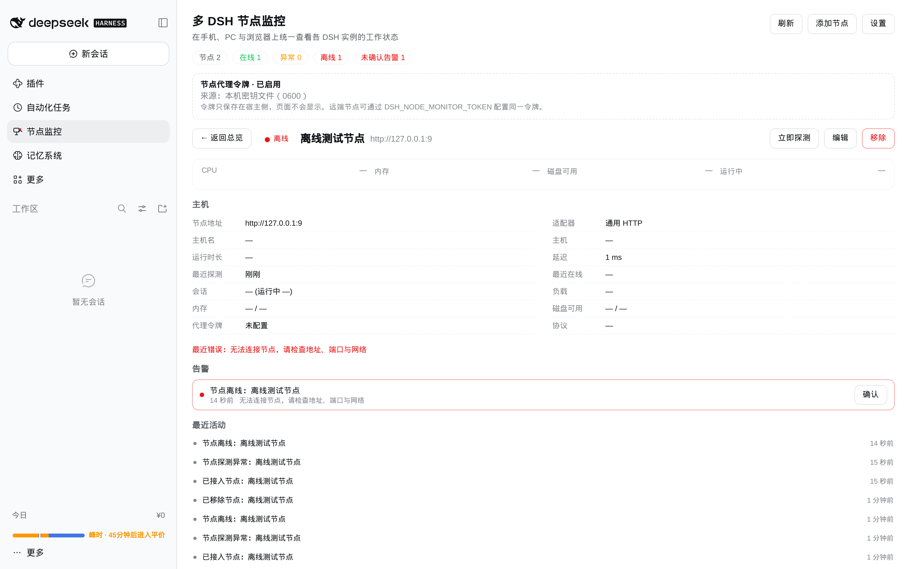
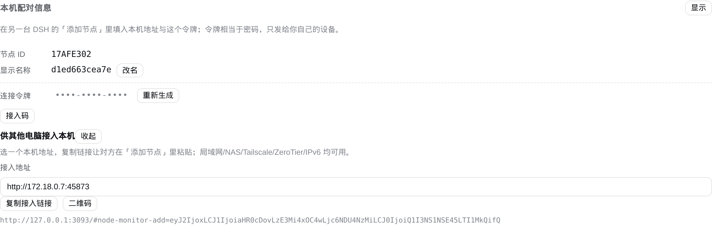
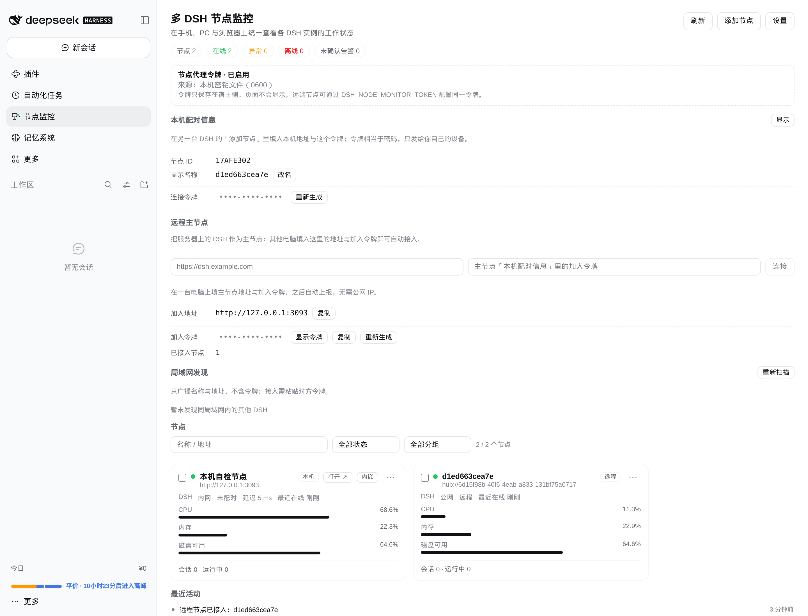
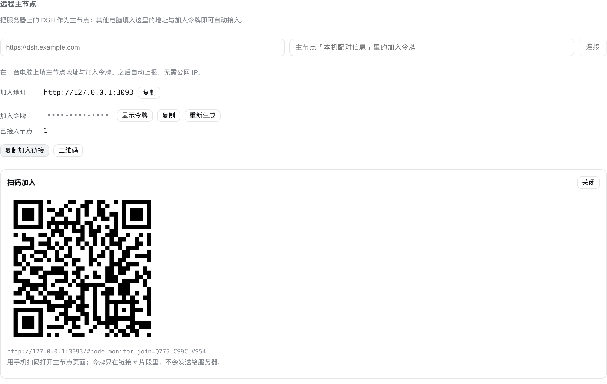

# dsh-node-monitor

English | [简体中文](README.md)

**Multi-node monitoring and control for DSH**: bring local, LAN and cross-network DSH instances into one left-sidebar panel to watch status, review read-only sessions, open, pair and operate them when needed.

- Fixed sidebar entry `Nodes` (order 20) with a matching main panel
- Works in DSH Web and Desktop on Windows / macOS / Linux (rendered in the browser, responsive)
- **Zero-config on the same LAN**: auto-discovery and auto-pairing, no `--host`, no manual setup
- Works without a public IP: invite links plus Tailscale / ZeroTier / direct IPv6
- If one DSH is publicly reachable, use it as a **remote hub**; other machines connect outbound
- Ops control is off by default; read-only tokens, dry-run, confirmation, audit log and rate limits

Repository: <https://github.com/qingshuiliuyun/dsh-node-monitor>  
Current version: **v0.6.5** (2026-11-12)  
Tests: `npm test` → **48/48** (30 unit + 18 integration)  
Packages: `dsh-node-monitor-dist/dsh-node-monitor-0.6.5.zip` / `.tgz`, or GitHub tag `v0.6.4`

---

## Features

| Capability | Description | Since |
| --- | --- | --- |
| Status overview | Node cards: online state, latency, CPU/memory/disk, session counts, recent activity, alerts | v0.1 |
| Node details | Host info, uptime, load, protocol, token state, recent events | v0.1 |
| Read-only sessions | Session ID/state/model/working directory/last activity only — conversation content is never read | v0.3 |
| Tasks and alerts | Threshold alerts, offline alerts, acknowledgement, event feed | v0.1 |
| Basic management | Add/edit/remove nodes, test connection, enable/disable probing, batch probe/enable/disable | v0.1 / v0.3.1 |
| Sidebar entry | Fixed icon with status colour (green/amber/red/grey), opens the main panel | v0.1 |
| Open the real DSH UI | One-time ticket 302 to the target login page; same-origin embedding when possible | v0.2 / v0.3 |
| Ops control | List/toggle plugins, restart (optional); off by default, dry-run + confirm + audit | v0.3 |
| LAN discovery | UDP 45871 broadcasts public identity only; joining still requires a token | v0.4 |
| Two-way pairing | Adding B makes B register A automatically; both sides see each other | v0.4.1 |
| Zero-config networking | Plugin listens on 45873; discovered peers auto-pair read-only tokens | v0.5 |
| Remote hub | A public/always-on DSH acts as hub; PCs push every 3s, no inbound ports | v0.6 |
| Join links / QR | Share hub onboarding; the token lives only in the URL `#` fragment | v0.6.1 |
| Serverless invite links | `http://<LAN/Tailscale/IPv6>:45873` + token in one link | v0.6.2 |
| Security hardening | Read-only token, hub command expiry, peer caps, request timeouts, audit rotation | v0.6.3 |

## Architecture at a glance

```
┌──────────────────────────── Browser (any device) ────────────────────────────┐
│  Sidebar "Nodes" → main panel                                                │
│    │ Connection RPC (DSH cookie auth, /node-monitor-rpc)                     │
└────┼─────────────────────────────────────────────────────────────────────────┘
     ▼
┌──────────────────────────── Host plugin (Node side) ─────────────────────────┐
│  NodeMonitorHost                                                             │
│   ├─ node registry / alerts / events / audit (~/.dsh/node-monitor)           │
│   ├─ probe scheduler (HTTP, 4s timeout, offline after 2 failures)            │
│   ├─ agent HTTP server (45873, dual-stack)                                   │
│   ├─ UDP discovery (45871) + auto-pairing                                    │
│   └─ hub client (optional, outbound POST every 3s)                           │
└────┬───────────────────────────────┬─────────────────────────────────────────┘
     │ Bearer HTTP (agentPort)       │ hub push/result
     ▼                               ▼
 other DSH nodes                 remote hub (public DSH)
```

Four typical topologies:

1. **Single machine / same LAN**: the plugin listens on 45873; UDP discovery auto-pairs. Zero config.
2. **Cross-network with one public DSH**: the public DSH is the hub; PCs push outbound, no port mapping.
3. **No public server**: Tailscale / ZeroTier / direct IPv6, using an invite link to add a node.
4. **Reverse proxy / domain**: set `publicUrl` so join links and QR codes point to the right origin.

## Install

### Option A: install from the DSH panel (recommended)

DSH → **Plugins** → **Add plugin** → paste one of the URLs below → install → **restart DSH**:

```
https://codeload.github.com/qingshuiliuyun/dsh-node-monitor/tar.gz/refs/tags/v0.6.5
```

The repository URL `https://github.com/qingshuiliuyun/dsh-node-monitor` also works (default branch).

### Option B: local directory (offline package)

Unpack `dsh-node-monitor-0.6.5.zip`, then either point "Add plugin" at the unpacked absolute path, or run:

```
dsh plugin add /absolute/path/dsh-node-monitor
```

### Option C: manual mount (not recommended)

Add `"dsh-node-monitor": "link:/absolute/path/dsh-node-monitor"` to the profile `package.json` and append `dsh-node-monitor` to `dsh.profile.bundles`. **Do not** edit `cordis.patch.yml`; the bundle patch is composed at load time.

### Upgrade and rollback

- Upgrade: repeat "Add plugin" with the new tag tarball → restart DSH.
- Rollback: install the previous tag → restart.
- After upgrading to v0.6.3+, **regenerate the connection token** so legacy auto-pairing full tokens stop working.

## Four ways to connect

### 1. Same LAN: install and go

Install on both machines and restart DSH:

1. On first run Windows may show a firewall prompt — **allow private/public networks** (TCP 45873, UDP 45871).
2. Open **Nodes** on either machine; the peer appears under LAN discovery within seconds.
3. Click **Join**, paste the 12-character token from the peer's **Local pairing info** → save.
4. Or do nothing: since v0.6 peers auto-pair (read-only status only).

> Corporate WiFi with AP isolation, or across VLANs, blocks broadcast — add the peer manually using the steps below.

### 2. Across the internet: one DSH as remote hub

Best when you have an always-on old PC, NAS or cloud server.

**Hub side**: install and restart, open **Nodes** → **Remote hub**, note:

- Join URL, e.g. `http://192.168.1.10:45873`, `http://100.x.x.x:45873` or `https://dsh.example.com`
- Join token: 12 characters; can be revealed, copied or regenerated

**PC side**: open **Nodes** → **Remote hub**, enter the hub join URL and token → connect. The hub panel then shows these PCs (tag **Remote**) with status, sessions and plugin toggling.

> Prefer the **45873** agent URL: it is the plugin's own service and bypasses DSH login/Host checks.  
> For cross-network setups, put hub and PCs in Tailscale, or front the hub with a cloudflared tunnel.

### 3. No server: invite links + virtual LAN / IPv6

1. Install v0.6.5 on both machines and restart.
2. On A: **Local pairing info** → **Invite** → pick an address (LAN IP / Tailscale 100.x / IPv6).
3. Copy the invite link (or let the other side scan the QR code).
4. On B: **Add node** → paste the link into the **node address** field → address and token are filled in → save.

Underlying network options: Tailscale (free tier is enough for home; no broadcast → use invite links), ZeroTier (layer 2, discovery may work directly), public IPv6 (check with `curl -6 ifconfig.co`), or a cloudflared tunnel.

### 4. Domain / reverse proxy

If the panel is reached through a domain (HTTPS reverse proxy), configure:

```yaml
- id: node-monitor
  name: 'dsh-node-monitor'
  config:
    publicUrl: 'https://dsh.example.com'   # or env DSH_NODE_MONITOR_PUBLIC_URL
```

Otherwise generated join links and QR codes point at `127.0.0.1`. The proxy only needs to forward `/` to the DSH port; 45873 is an optional direct port.

## UI guide

- **Sidebar**: icon colour is the aggregate state (red: critical alert / offline node; amber: alerts or degraded; green: all online; grey: unknown).
- **Overview**: summary chips, alert list (ack / ack all / open node), node cards (CPU/memory/disk, sessions, latency), filters (keyword/state/tag), batch bar (probe/enable/disable), event feed.
- **Node detail**: state, probe/edit/remove, metrics, host info, read-only sessions, ops control (off by default), alerts, node events, protocol/host details.
- **Local pairing info**: node ID, display name (editable), connection token (reveal/copy/regenerate), invite link (multiple addresses + QR).
- **LAN discovery**: discovered peers, joined or not.
- **Remote hub**: enter URL + token when unconnected; when connected show state; on the hub side show join URL/token, joined count, copy join link and QR code.
- **Add/edit node**: name is optional (auto-filled from the remote hostname), address, adapter (DSH/generic HTTP), network, notes, token, tags, probing; pasting a join/invite link is parsed automatically.
- **Mobile**: single column at ≤760px; batch bar and filters wrap; embedded view is full-screen.

## Security model

Several tokens with distinct permissions (see [docs/SECURITY.md](docs/SECURITY.md)):

| Token | Permissions | Used for |
| --- | --- | --- |
| `agentToken` (connection token) | Full: status, session metadata, control | Manual node add, invite links |
| `statusToken` (read-only token) | Read-only: counts/metrics, no session details or recent events, no control | LAN discovery / auto-pairing |
| `hubToken` (join token) | Hub push/pull only | PC connecting to a remote hub |
| `nodeTokens.*` | Token of the corresponding node | Hub accessing added nodes |

- Ops control is off by default: requires `allowControl: true` / `DSH_NODE_MONITOR_ALLOW_CONTROL=1`; restart is also off by default.
- Control requests default to dry-run; real execution requires `confirm: true`; every call is written to `audit.jsonl` (0600).
- Join/invite tokens live only in the URL `#` fragment and are never sent to the server; QR codes are generated locally.
- `~/.dsh/node-monitor/secrets.json` is 0600 and its directory 0700; tokens never enter state, logs, or non-owner responses.
- Auto-pairing exchanges read-only tokens only; auto-joined nodes are read-only — paste a full token to operate them.

## Configuration

Plugin config (profile patch `config`, requires a DSH restart):

| Key | Environment variable | Default | Description |
| --- | --- | --- | --- |
| `home` | `DSH_HOME` | `~/.dsh` | State and secrets directory |
| `label` | — | hostname | LAN display name |
| `discovery` | `DSH_NODE_MONITOR_DISCOVERY=0` | `true` | Enable UDP discovery |
| `discoveryPort` | `DSH_NODE_MONITOR_DISCOVERY_PORT` | `45871` | Discovery port |
| `discoveryPeers` | `DSH_NODE_MONITOR_DISCOVERY_PEERS` | — | Unicast discovery targets, `host:port,host:port` |
| `agentPort` | `DSH_NODE_MONITOR_AGENT_PORT` | `45873` | Agent port (dual-stack) |
| `publicListen` | `DSH_NODE_MONITOR_PUBLIC_LISTEN=0` | `true` | Listen on `::`/`0.0.0.0` |
| `autoPair` | `DSH_NODE_MONITOR_AUTO_PAIR=0` | `true` | Auto-pair discovered peers |
| `allowControl` | `DSH_NODE_MONITOR_ALLOW_CONTROL=1` | `false` | Allow remote plugin toggling |
| `allowRestart` | `DSH_NODE_MONITOR_ALLOW_RESTART=1` | `false` | Allow remote DSH restart |
| `hub` | `DSH_NODE_MONITOR_HUB=0` | `true` | Accept remote node reports |
| `publicUrl` | `DSH_NODE_MONITOR_PUBLIC_URL` | — | Public origin for links/QR |

Runtime settings (panel **Settings**): `refreshMs` 5000, `timeoutMs` 4000, `offlineAfterFailures` 2, `latencyWarnMs` 1500, `cpuWarnPct` 85, `memWarnPct` 90, `diskWarnFreePct` 10, `eventsLimit` 40.

## API quick reference

Panel ↔ host: Connection RPC channel `/node-monitor-rpc`, owner-only (except read-only state). Actions:
`state`, `refresh`, `addNode`, `updateNode`, `removeNode`, `ackAlert`, `ackAll`, `batchNodes`, `settings`, `testNode`, `setLogin`, `clearLogin`, `openTicket`, `control`, `hubJoin`, `nodeInvite`, `hubInfo`, `hubConnect`, `hubDisconnect`, `hubRotateToken`, `discoveryProbe`, `selfToken`, `rotateToken`, `updateLabel`.

Agent HTTP (45873 / DSH port):

| Endpoint | Auth | Description |
| --- | --- | --- |
| `GET /node-monitor/api/v1/health` | none | Liveness probe |
| `GET /node-monitor/api/v1/status` | Bearer agentToken / statusToken | Status snapshot; read-only token gets the reduced view |
| `POST /node-monitor/api/v1/control` | Bearer agentToken | Ops actions (requires allowControl) |
| `POST /node-monitor/api/v1/pair` | Bearer agentToken or auto | Two-way registration (LAN sources only) |
| `POST /node-monitor/api/v1/hub/push` | Bearer hubToken | PC report + queued commands |
| `POST /node-monitor/api/v1/hub/result` | Bearer hubToken | Command results |
| `GET /node-monitor/open` | one-time ticket | 302 to the node's login page |

UDP discovery: 45871, multicast `239.255.43.21`, every 30s, 5-minute TTL; fields in [DESIGN.md](DESIGN.md) §7.3.

## Documentation

| Document | Contents |
| --- | --- |
| [DESIGN.md](DESIGN.md) | Architecture, data model, protocol spec, security, deployment, tests |
| [docs/ARCHITECTURE-DECISIONS.md](docs/ARCHITECTURE-DECISIONS.md) | ADRs: trade-offs and rejected alternatives |
| [docs/INSTALL.md](docs/INSTALL.md) | Scenario-based install, ports/firewall, upgrade/rollback, troubleshooting |
| [docs/SECURITY.md](docs/SECURITY.md) | Threat model, token matrix, data exposure, hardening checklist |
| [docs/ARCHITECTURE-DECISIONS.md](docs/ARCHITECTURE-DECISIONS.md) | ADRs: trade-offs and rejected alternatives |
| [docs/CHANGELOG.md](docs/CHANGELOG.md) | Version history |
| [README.md](README.md) | 简体中文 README |
| [docs/screenshots/](docs/screenshots) | UI screenshots (v0.6.x) |
| [market/PUBLISH.md](market/PUBLISH.md) | Marketplace submission notes |

## Screenshots

| Overview | Multiple nodes |
| --- | --- |
|  |  |

| Node detail | Invite link |
| --- | --- |
|  |  |

| Remote hub | Join QR |
| --- | --- |
|  |  |

## Development and tests

```bash
npm test                 # 48/48
node --test --test-force-exit test/core.test.js
node --test --test-force-exit test/host.test.js
```

- No runtime dependencies; QR codes use bundled `lib/qrcode.js` (qrcode-generator 2.0.4, MIT).
- Layout: `lib/core.js` (pure logic/protocol), `lib/index.js` (host), `lib/client.js` (browser bundle), `lib/qrcode.js`.
- Tests: `test/core.test.js` (30), `test/host.test.js` (18, including real `node:http` round-trips).

## Troubleshooting

| Symptom | Check |
| --- | --- |
| Node shows "Unpaired" | Edit the node and paste its full token; or re-add it via an invite link |
| Node offline | `curl http://<peer>:45873/node-monitor/api/v1/health`; allow TCP 45873 in Windows Firewall |
| LAN discovery empty | Same broadcast domain? AP isolation? UDP 45871 allowed? Corporate WiFi: add manually or use invite links |
| Join link opens `127.0.0.1` | Reverse-proxy deployments must set `publicUrl` / `DSH_NODE_MONITOR_PUBLIC_URL` |
| Opening a node returns 401 | The target DSH launch token rotated; re-pair its login material |
| Control returns 403 | Target has `allowControl` off, or the node is an auto-joined read-only node — use a full token |
| Batch/control `unknown-endpoint` | Host still runs old code; restart DSH |
| Hub does not show the PC | Is the PC connected? Is the hub's 45873 reachable? Is the token correct? |

## Repository layout

```
dsh-node-monitor/
├─ lib/            # core.js / index.js / client.js / qrcode.js
├─ locale/         # zh.json / en.json
├─ test/           # core.test.js / host.test.js
├─ docs/           # INSTALL / SECURITY / CHANGELOG / ARCHITECTURE-DECISIONS / screenshots
├─ market/         # marketplace submission material
├─ assets/         # storefront icon
├─ cordis.patch.yml
├─ package.json
├─ README.md
├─ README.en.md
└─ DESIGN.md
```

## Roadmap

- Expiring invite links (default 10 minutes, renewable)
- Persist hub peers so they survive restart immediately
- Notification channels (webhook/email/IM) and quiet hours
- Read-only session timeline and finer task progress
- Multi-user/RBAC and approval workflows
- npm publishing and update notices once listed in the marketplace

## License

MIT
