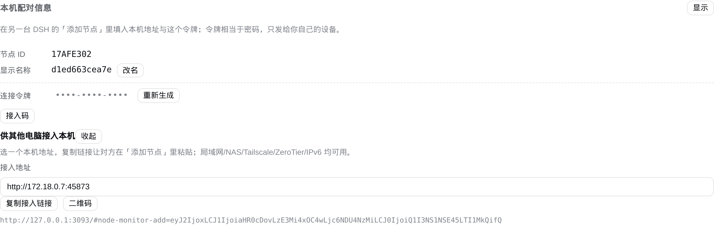
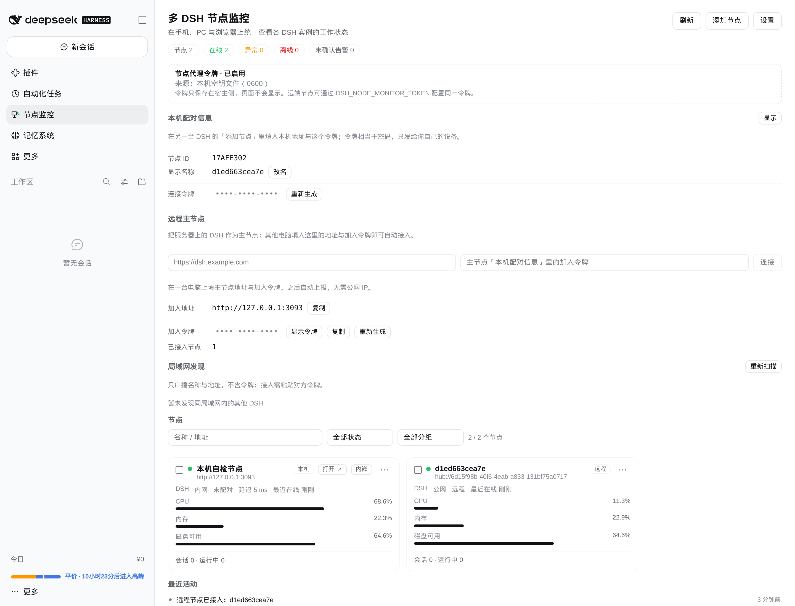
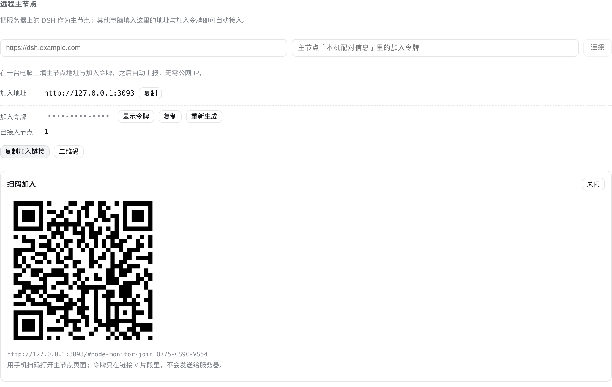

# dsh-node-monitor

[English](README.en.md) | 简体中文

**多 DSH 节点监控与管控插件**：把本机、局域网、跨公网的多台 DSH 收进同一个左侧栏面板，查看状态、会话概览，按需远程打开、配对和运维。

- 左侧栏固定入口 `节点监控`（order 20），主面板同 id
- 支持 Windows / macOS / Linux 的 DSH Web 与桌面端（浏览器内渲染，响应式）
- 同一局域网内**装完即用**：自动发现、自动互加，无需 `--host`、无需手工配置
- 没有公网 IP 也能连：接入码 + Tailscale / ZeroTier / IPv6 直连
- 有一台公网可访问的 DSH 时，可把它当**远程主节点（Hub）**，其余机器出站反连
- 运维控制默认关闭；只读令牌、dry-run、二次确认、审计日志、限流

仓库：<https://github.com/qingshuiliuyun/dsh-node-monitor>  
当前版本：**v0.6.6**（2026-11-12）  
测试：`npm test` → **50/50**（30 单测 + 20 集成）  
安装包：`dsh-node-monitor-dist/dsh-node-monitor-0.6.6.zip` / `.tgz` 或 GitHub tag `v0.6.4`

---

## 功能总览

| 能力 | 说明 | 起始版本 |
| --- | --- | --- |
| 状态总览 | 节点卡片：在线状态、延迟、CPU/内存/磁盘、会话数、最近活动、告警 | v0.1 |
| 节点详情 | 主机信息、运行时长、负载、协议、令牌状态、最近事件 | v0.1 |
| 只读会话概览 | 仅展示会话 ID/状态/模型/工作目录/最近活动时间，不读取对话内容 | v0.3 |
| 任务与告警 | 阈值告警、离线告警、告警确认、事件流 | v0.1 |
| 基础管理 | 添加/编辑/删除节点、测试连接、启停探测、批量探测/启停 | v0.1 / v0.3.1 |
| 左侧栏入口 | 固定图标 + 状态色（绿/黄/红/灰），点击进入主面板 | v0.1 |
| 一键打开真实 DSH | 用一次性票据 302 到目标节点登录页；同源时可内嵌 | v0.2 / v0.3 |
| 运维控制 | 插件列表/启停、重启（可选）；默认关闭，dry-run + confirm + 审计 | v0.3 |
| 局域网自动发现 | UDP 45871 广播公开身份，不广播令牌；令牌确认后接入 | v0.4 |
| 双向配对 | A 添加 B 后，B 自动登记 A，两侧都出现对方 | v0.4.1 |
| 零配置自动组网 | 插件自监听 45873，发现后自动互加（只交换只读令牌） | v0.5 |
| 远程主节点 Hub | 公网/常开 DSH 作 Hub，PC 每 3s 出站上报，跨 NAT 无需入站端口 | v0.6 |
| 加入链接 / 二维码 | Hub 一键分享加入信息，链接令牌只放 URL `#` 片段 | v0.6.1 |
| 无服务器接入码 | `http://<LAN/Tailscale/IPv6>:45873` + 令牌，一条链接完成添加 | v0.6.2 |
| 安全加固 | 只读令牌、Hub 命令过期、peer 上限、请求超时、审计轮转 | v0.6.3 |

## 架构速览

```
┌────────────────────────── 浏览器（任意设备） ──────────────────────────┐
│  左侧栏「节点监控」→ main 面板                                          │
│    │ Connection RPC（DSH Cookie 认证，/node-monitor-rpc）               │
└────┼───────────────────────────────────────────────────────────────────┘
     ▼
┌────────────────────────── 宿主插件（Node 侧） ─────────────────────────┐
│  NodeMonitorHost                                                       │
│   ├─ 节点注册表 / 告警 / 事件 / 审计（~/.dsh/node-monitor）              │
│   ├─ 探测调度（HTTP，4s 超时，失败 2 次离线）                            │
│   ├─ agent HTTP 服务（45873，双栈）                                     │
│   ├─ UDP 发现（45871）+ 自动配对                                        │
│   └─ Hub 客户端（可选，3s 出站 POST）                                   │
└────┬───────────────────────────────┬───────────────────────────────────┘
     │ Bearer HTTP（agentPort）       │ Hub push/result
     ▼                               ▼
 其他 DSH 节点                   远程主节点（公网 DSH）
```

四种典型拓扑：

1. **单机 / 同局域网**：插件自监听 45873，UDP 发现后自动互加，零配置。
2. **跨网络 + 一台公网 DSH**：公网 DSH 作 Hub，PC 出站 `hub/push`，无需端口映射。
3. **无公网服务器**：Tailscale / ZeroTier / IPv6 直连，用「接入码」一条链接添加节点。
4. **反代/域名部署**：配置 `publicUrl`，面板生成正确的加入链接与二维码。

## 安装

### 方式 A：在 DSH 面板里安装（推荐）

DSH →「插件」→「添加插件」→ 粘贴以下任一地址 → 安装 → **重启 DSH**：

```
https://codeload.github.com/qingshuiliuyun/dsh-node-monitor/tar.gz/refs/tags/v0.6.6
```

也支持直接填 GitHub 仓库地址 `https://github.com/qingshuiliuyun/dsh-node-monitor`（会拉默认分支）。

### 方式 B：本地目录（离线包）

解压 `dsh-node-monitor-0.6.6.zip`，在「添加插件」里填解压后的目录绝对路径，或在 profile 里用：

```
dsh plugin add /绝对路径/dsh-node-monitor
```

### 方式 C：手工挂载（不推荐）

在 profile 的 `package.json` 里加 `"dsh-node-monitor": "link:/绝对路径/dsh-node-monitor"`，并把 `dsh-node-monitor` 加入 `dsh.profile.bundles`；**不要**改 `cordis.patch.yml`（bundle 自带的 patch 会在加载时合成）。

### 升级与回滚

- 升级：重复「添加插件」并填新 tag 的 tarball 地址 → 重启 DSH。
- 回滚：填旧 tag 地址重装 → 重启。
- 升级 v0.6.3+ 后建议在面板里**重新生成连接令牌**，让旧版自动配对留下的完整令牌立即失效。

## 四种组网方式

### 1. 同一局域网：装完即用

两台机器都装插件并重启 DSH：

1. Windows 首次运行会弹防火墙，**允许专用/公用网络**（TCP 45873、UDP 45871）。
2. 打开任意一台的「节点监控」→ 几秒后「局域网发现」出现对方。
3. 点「接入」，粘贴对方「本机配对信息」里的 12 位令牌 → 保存。
4. 也可以什么都不做：v0.6 起会自动互加，双方都出现对方（只读状态）。

> 企业 WiFi 开了 AP 隔离、或跨 VLAN 时，广播到不了，用下面的方式手工加。

### 2. 跨公网：一台 DSH 当远程主节点（Hub）

适合有一台常开的旧电脑、NAS、云服务器。

**Hub 侧**：装插件并重启，打开「节点监控」→「远程主节点」，记下：

- 加入地址：例如 `http://192.168.1.10:45873`、`http://100.x.x.x:45873` 或 `https://dsh.example.com`
- 加入令牌：12 位，可显示/复制/重新生成

**PC 侧**：打开「节点监控」→「远程主节点」，地址填 Hub 的加入地址、令牌填 Hub 的加入令牌 → 连接。之后 Hub 面板会持续显示这些 PC（标签「远程」），状态/会话/插件启停可用。

> 优先填 **45873** 的 agent 地址：它是插件自己的服务，绕过 DSH 登录与 Host 校验。  
> 跨网络时建议 Hub 与 PC 都在 Tailscale 里，或给 Hub 套 cloudflared 隧道。

### 3. 没有服务器：接入码 + 虚拟局域网 / IPv6

1. 两台都装 v0.6.6 并重启。
2. A：「本机配对信息」→「接入码」→ 选一个本机地址（局域网 IP / Tailscale 100.x / IPv6）。
3. 复制接入链接（或让对方扫二维码）。
4. B：「添加节点」→ 把链接粘贴到**节点地址**输入框 → 地址和令牌自动填好 → 保存。

底层网络任选：Tailscale（免费额度够家庭，不支持广播 → 用接入码）、ZeroTier（二层，可能直接广播发现）、公网 IPv6（`curl -6 ifconfig.co` 确认）、cloudflared 隧道。

### 4. 域名 / 反向代理

如果面板通过域名访问（HTTPS 反代），配置：

```yaml
- id: node-monitor
  name: 'dsh-node-monitor'
  config:
    publicUrl: 'https://dsh.example.com'   # 或环境变量 DSH_NODE_MONITOR_PUBLIC_URL
```

否则生成的加入链接/二维码会指向 `127.0.0.1`。反代只需把 `/` 转发到 DSH 端口；45873 是可选直连端口。

## 界面说明

- **左侧栏**：图标颜色=汇总状态（红：严重告警/有节点离线；黄：有告警/异常；绿：全部在线；灰：未知）。
- **总览**：汇总 chips、告警列表（确认/全部确认/打开节点）、节点卡片（CPU/内存/磁盘、会话、延迟）、筛选（关键字/状态/分组）、批量栏（探测/启用/停用）、事件流。
- **节点详情**：状态、探测/编辑/删除、指标、主机信息、会话概览（只读）、运维控制（默认关闭）、告警、节点事件、协议与主机信息。
- **本机配对信息**：节点 ID、显示名（可改）、连接令牌（显示/复制/重新生成）、接入码（多地址 + 二维码）。
- **局域网发现**：广播到的节点、已接入/接入。
- **远程主节点**：未连接时填地址+令牌；已连接显示状态；Hub 侧显示加入地址/令牌、已接入数量、复制加入链接、二维码。
- **添加/编辑节点**：名称可留空（自动取远端 hostname）、地址、适配器（DSH/通用 HTTP）、网络、备注、令牌、标签、启用探测；粘贴加入链接/接入码会自动解析。
- **移动端**：≤760px 单列，批量栏与筛选自动换行，内嵌视图全屏。

## 安全模型

插件同时使用几种令牌，权限严格区分（详见 [docs/SECURITY.md](docs/SECURITY.md)）：

| 令牌 | 权限 | 使用场景 |
| --- | --- | --- |
| `agentToken`（连接令牌） | 完整：状态、会话元数据、控制 | 手动添加节点、接入码 |
| `statusToken`（只读令牌） | 只读：计数/指标，无会话明细、无最近事件、不能控制 | 局域网自动发现/自动配对 |
| `hubToken`（加入令牌） | 只允许 Hub 上报/领命令 | PC 连接远程主节点 |
| `nodeTokens.*` | 对应节点的令牌 | Hub 访问已添加节点 |

- 运维控制默认关闭：`allowControl: true` / `DSH_NODE_MONITOR_ALLOW_CONTROL=1` 才可用；重启默认也关。
- 控制请求默认 dry-run，真实执行需 `confirm: true`；每次调用写 `audit.jsonl`（0600）。
- 加入链接/接入码令牌只放在 URL `#` 片段，不发给服务器；二维码本地生成。
- 令牌文件 `~/.dsh/node-monitor/secrets.json` 0600，目录 0700；令牌不进 state、不进日志、不返回给非 owner。
- 自动配对只交换只读令牌；自动接入的节点是只读的，要远程运维需手动粘贴完整令牌。

## 配置

插件配置（profile patch 的 `config`，需重启 DSH）：

| 键 | 环境变量 | 默认 | 说明 |
| --- | --- | --- | --- |
| `home` | `DSH_HOME` | `~/.dsh` | 状态与密钥目录 |
| `label` | — | 主机名 | 局域网显示名 |
| `discovery` | `DSH_NODE_MONITOR_DISCOVERY=0` | `true` | 是否启用 UDP 发现 |
| `discoveryPort` | `DSH_NODE_MONITOR_DISCOVERY_PORT` | `45871` | 发现端口 |
| `discoveryPeers` | `DSH_NODE_MONITOR_DISCOVERY_PEERS` | — | 单播发现目标，`host:port,host:port` |
| `agentPort` | `DSH_NODE_MONITOR_AGENT_PORT` | `45873` | agent 服务端口（双栈） |
| `publicListen` | `DSH_NODE_MONITOR_PUBLIC_LISTEN=0` | `true` | 是否监听 `::`/`0.0.0.0` |
| `autoPair` | `DSH_NODE_MONITOR_AUTO_PAIR=0` | `true` | 是否自动互加 |
| `allowControl` | `DSH_NODE_MONITOR_ALLOW_CONTROL=1` | `false` | 允许远程插件启停 |
| `allowRestart` | `DSH_NODE_MONITOR_ALLOW_RESTART=1` | `false` | 允许远程重启 DSH |
| `hub` | `DSH_NODE_MONITOR_HUB=0` | `true` | 是否接受远程节点上报 |
| `publicUrl` | `DSH_NODE_MONITOR_PUBLIC_URL` | — | 对外 origin，用于链接/二维码 |

运行时设置（面板「设置」）：`refreshMs` 5000、`timeoutMs` 4000、`offlineAfterFailures` 2、`latencyWarnMs` 1500、`cpuWarnPct` 85、`memWarnPct` 90、`diskWarnFreePct` 10、`eventsLimit` 40。

## 接口速查

面板 ↔ 宿主：Connection RPC 通道 `/node-monitor-rpc`，全部 owner-only（除只读状态），动作：
`state`、`refresh`、`addNode`、`updateNode`、`removeNode`、`ackAlert`、`ackAll`、`batchNodes`、`settings`、`testNode`、`setLogin`、`clearLogin`、`openTicket`、`control`、`hubJoin`、`nodeInvite`、`hubInfo`、`hubConnect`、`hubDisconnect`、`hubRotateToken`、`discoveryProbe`、`selfToken`、`rotateToken`、`updateLabel`。

Agent HTTP（45873 / DSH 端口）：

| 端点 | 认证 | 说明 |
| --- | --- | --- |
| `GET /node-monitor/api/v1/health` | 无 | 存活探测 |
| `GET /node-monitor/api/v1/status` | Bearer agentToken / statusToken | 状态快照；只读令牌返回精简版 |
| `POST /node-monitor/api/v1/control` | Bearer agentToken | 运维动作（需 allowControl） |
| `POST /node-monitor/api/v1/pair` | Bearer agentToken 或 auto | 双向登记（仅局域网来源） |
| `POST /node-monitor/api/v1/hub/push` | Bearer hubToken | PC 上报 + 领取命令 |
| `POST /node-monitor/api/v1/hub/result` | Bearer hubToken | 命令执行结果 |
| `GET /node-monitor/open` | 一次性票据 | 302 到节点登录页 |

UDP 发现：45871，组播 `239.255.43.21`，30s 一次，TTL 5 分钟，字段见 [DESIGN.md](DESIGN.md) §7.3。协议细节见 DESIGN。

## 文档

| 文档 | 内容 |
| --- | --- |
| [DESIGN.md](DESIGN.md) | 总体架构、数据模型、协议规格、安全模型、部署与测试 |
| [docs/INSTALL.md](docs/INSTALL.md) | 分场景安装、端口/防火墙、升级回滚、排障 |
| [docs/SECURITY.md](docs/SECURITY.md) | 威胁模型、令牌矩阵、数据暴露面、加固清单 |
| [docs/ARCHITECTURE-DECISIONS.md](docs/ARCHITECTURE-DECISIONS.md) | 架构决策记录（ADR）：取舍与备选方案 |
| [docs/CHANGELOG.md](docs/CHANGELOG.md) | 版本历史 |
| [README.en.md](README.en.md) | English README |
| [docs/screenshots/](docs/screenshots) | 界面截图（v0.6.x） |
| [market/PUBLISH.md](market/PUBLISH.md) | 插件市场提交说明 |

## 界面截图

| 总览 | 多节点 |
| --- | --- |
|  |  |

| 节点详情 | 接入码 |
| --- | --- |
|  |  |

| 远程主节点 | 加入二维码 |
| --- | --- |
|  |  |

## 开发与测试

```bash
npm test                 # 50/50
node --test --test-force-exit test/core.test.js
node --test --test-force-exit test/host.test.js
```

- 无运行时依赖；二维码使用内置 `lib/qrcode.js`（qrcode-generator 2.0.4，MIT）。
- 目录：`lib/core.js`（纯逻辑/协议）、`lib/index.js`（宿主）、`lib/client.js`（浏览器 bundle）、`lib/qrcode.js`。
- 测试：`test/core.test.js`（30）、`test/host.test.js`（18，含真实 `node:http` 往返）。

## 故障排查

| 现象 | 排查 |
| --- | --- |
| 面板显示「未配对」 | 编辑节点粘贴对方完整令牌；或重新用接入码添加 |
| 节点离线 | `curl http://<对端>:45873/node-monitor/api/v1/health`；Windows 防火墙放行 TCP 45873 |
| 局域网发现为空 | 同一广播域？AP 隔离？UDP 45871 放行？企业 WiFi 改用手工添加/接入码 |
| 加入链接打开是 127.0.0.1 | 反代部署需配置 `publicUrl` / `DSH_NODE_MONITOR_PUBLIC_URL` |
| 打开节点 401 | 目标 DSH 的启动令牌已轮换，重新配对登录材料 |
| 控制返回 403 | 目标节点未开 `allowControl`；自动接入节点只读，需完整令牌 |
| 批量/控制 `unknown-endpoint` | 宿主仍是旧代码，重启 DSH |
| Hub 看不到 PC | PC「远程主节点」是否已连接；Hub 的 45873 是否可达；令牌是否正确 |

## 目录结构

```
dsh-node-monitor/
├─ lib/            # core.js / index.js / client.js / qrcode.js
├─ locale/         # zh.json / en.json
├─ test/           # core.test.js / host.test.js
├─ docs/           # INSTALL.md / SECURITY.md / CHANGELOG.md / screenshots/
├─ market/         # 插件市场提交材料
├─ assets/         # 市场图标
├─ cordis.patch.yml
├─ package.json
├─ README.md
└─ DESIGN.md
```

## 路线图

- 接入码有效期（默认 10 分钟，可续期）
- Hub peer 列表持久化，重启立即恢复
- 通知通道（Webhook/邮件/IM）与静默时段
- 会话时间线（只读）与任务进度细分
- 多用户/RBAC 与操作审批
- npm 发布与市场收录后的自动更新提示

## License

MIT
