# dsh-node-monitor

> 仓库：<https://github.com/qingshuiliuyun/dsh-node-monitor> · 安装包见 `dsh-node-monitor-dist/` 或 Releases。

多 DSH 节点互联监控插件：在**左侧栏固定入口**打开统一面板，查看 Windows PC、云服务器、手机与浏览器上每一个 DSH 实例的在线状态、会话/任务负载、指标、日志摘要与告警，并可做基础管理。

- 总览：节点卡片、健康度、在线/异常/离线统计、告警、最近活动
- 详情：CPU/内存/磁盘/会话指标、主机信息、探测延迟、节点告警、最近事件
- 实时：宿主每 5s 探测一轮，面板按设置轮询 `state`；断线自动指数退避，页面隐藏时暂停
- 安全：节点令牌只保存在宿主侧 `0600` 密钥文件；RPC 走 DSH 已认证的 Connection 通道；agent 端点强制 Bearer + 恒时比较 + 限流
- 自适应：桌面/手机响应式布局，侧栏图标用状态色点直接显示健康度
- 多机 Hub（v0.2.0）：给节点配对「登录材料」后，点卡片上的「打开」即在新标签页进入该节点的**真实 DSH 界面**（同一套 UI、同样的会话与任务能力），不需要在 Hub 里重写聊天

> 设计说明、接口契约与验收标准见 [DESIGN.md](./DESIGN.md)。

## 界面预览

左侧栏入口（图标内状态点 = 全局健康度）：

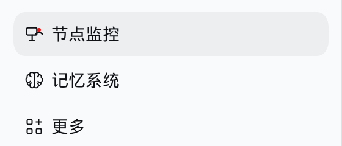

总览：节点卡片、统计、告警、最近活动

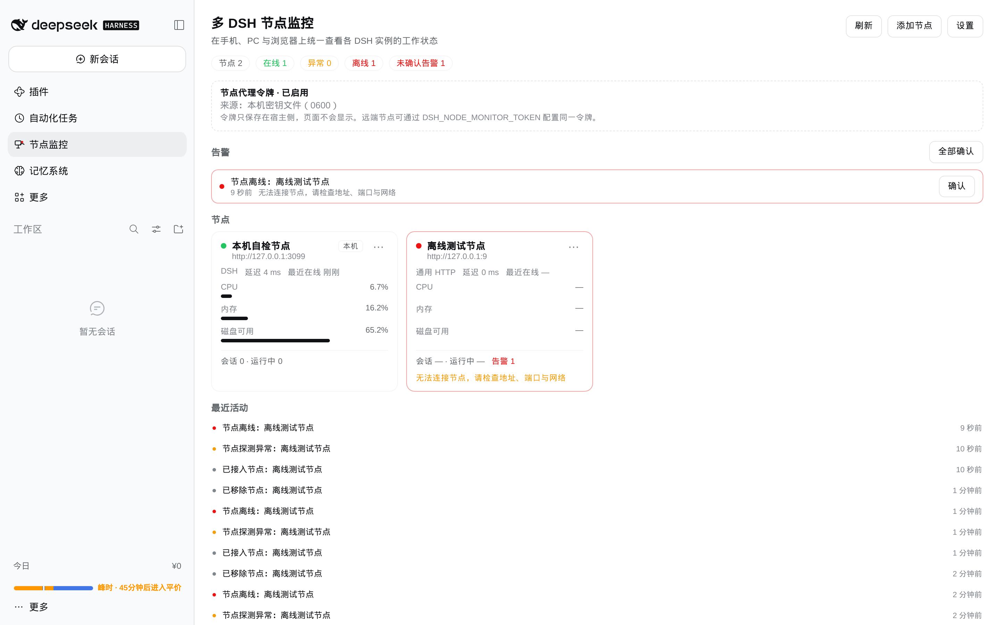

两路真实 DSH 实例（3099 本机 + 3098 第二实例）同时在线：

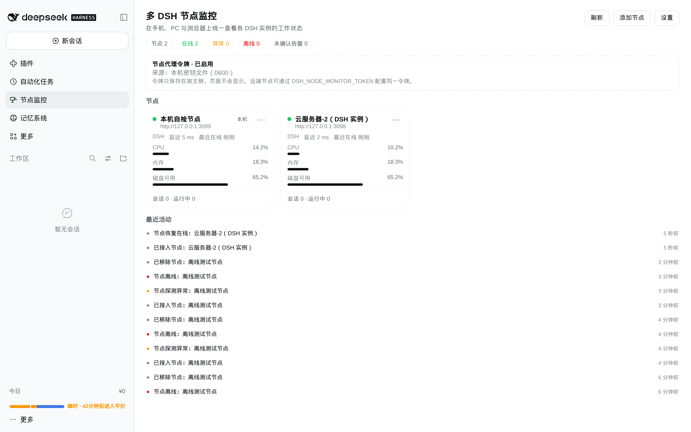

节点详情：指标、主机信息、节点告警、最近活动

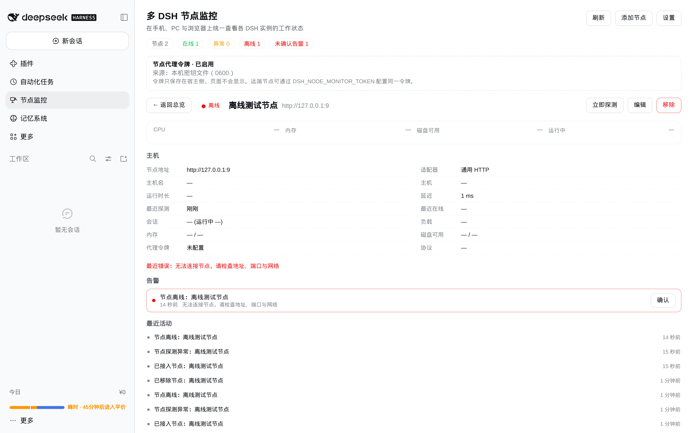

添加节点（含「测试连接」）：

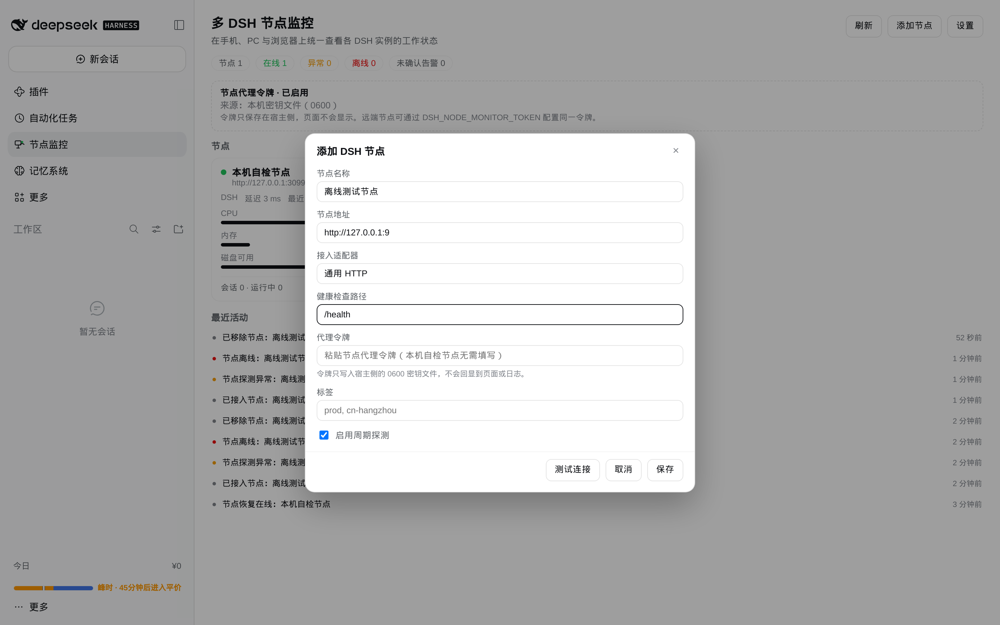

移动端 390×844 单列布局：

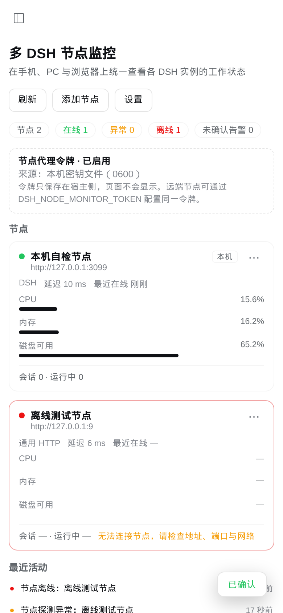

### 多机 Hub（v0.2.0）：一键打开远端真实 DSH

两台真实实例同时在线，卡片头部直接提供「打开」；第二台节点已配对登录材料（Tailscale）：

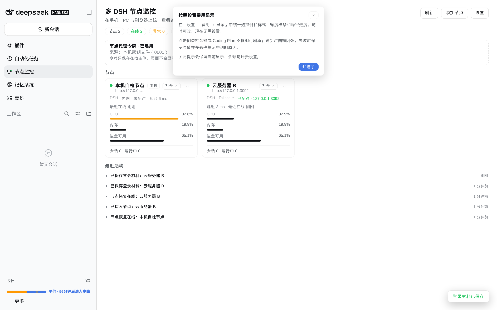

编辑节点时配对登录地址（令牌只落宿主 0600 文件，页面不回显）：

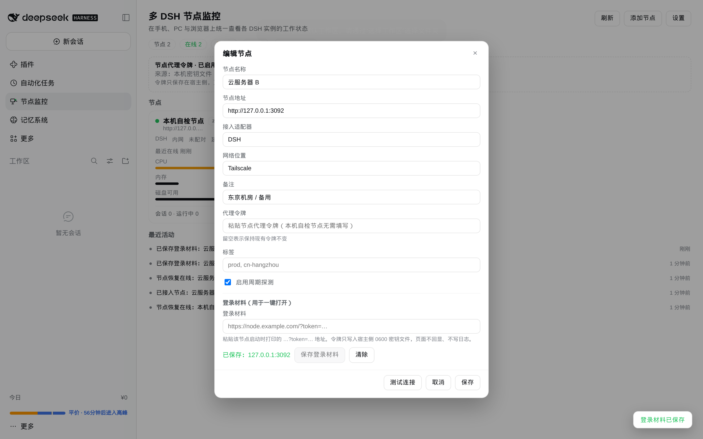

点「打开」后的新标签页：已经进入远端实例自己的 DSH 界面（左侧栏、会话、任务都是它自己的）：

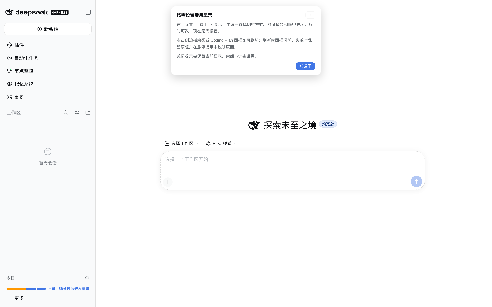

Hub 的移动端视图（390×844）：

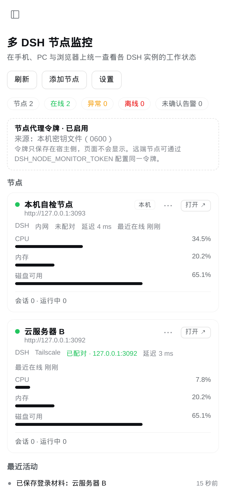

### 会话概览（H1）：只读，不读对话内容

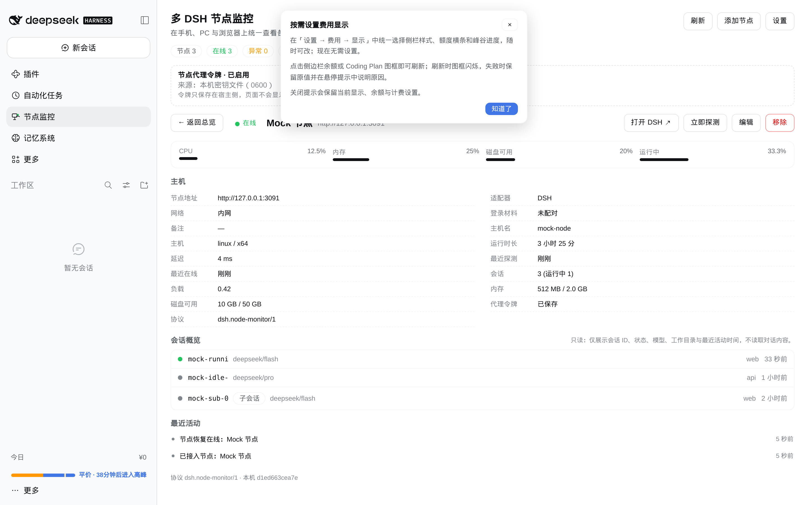

### 运维控制（H3）：dry-run + 行内确认 + 节点侧审计

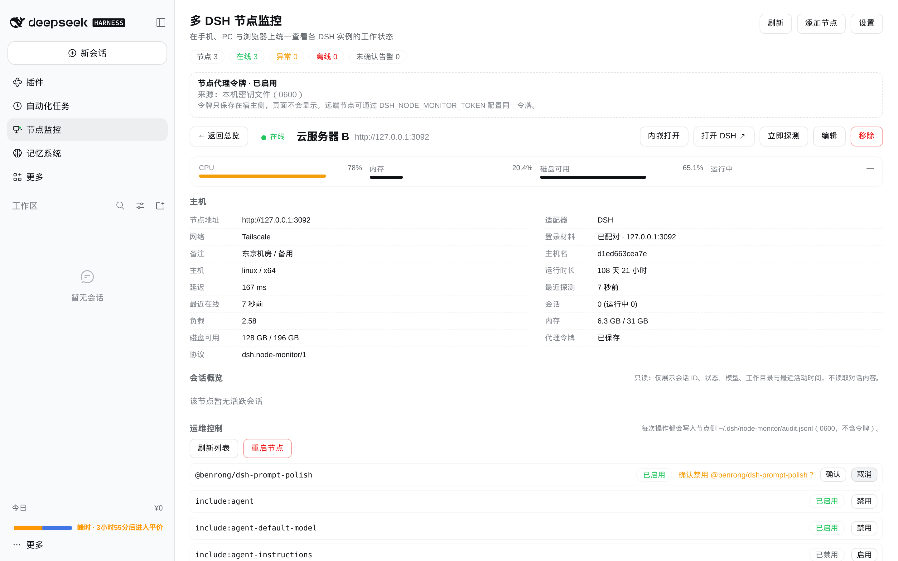

### 同源内嵌（H2）：在 Hub 里直接操作远端 DSH

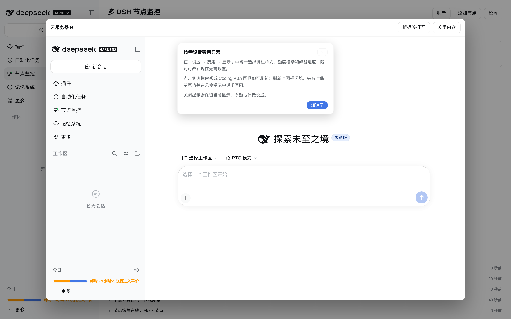

### 分组筛选 + 告警联动（H4）

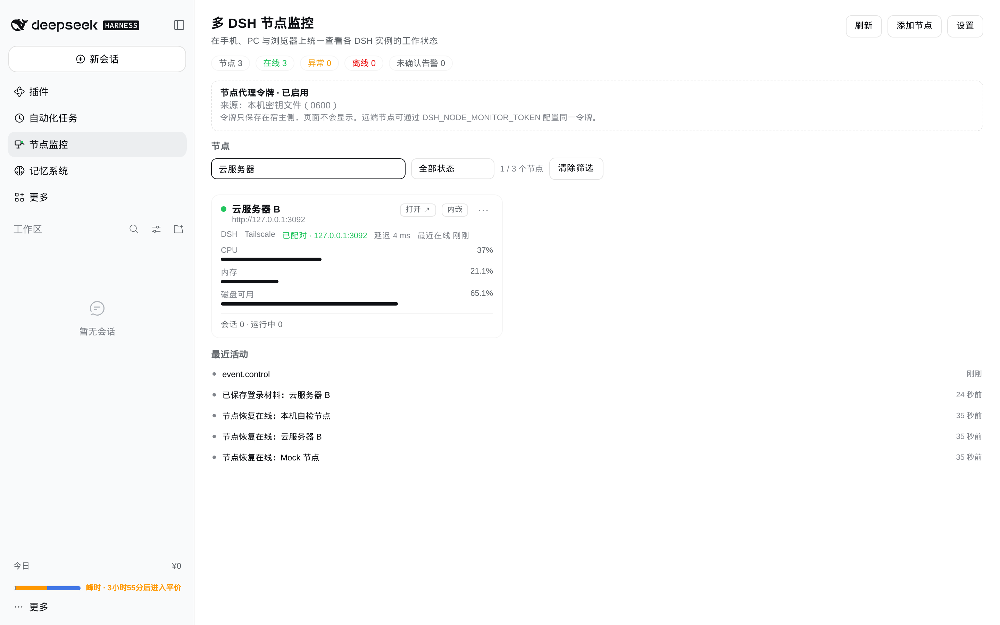

### 批量操作（H4）：多选探测/启用/停用

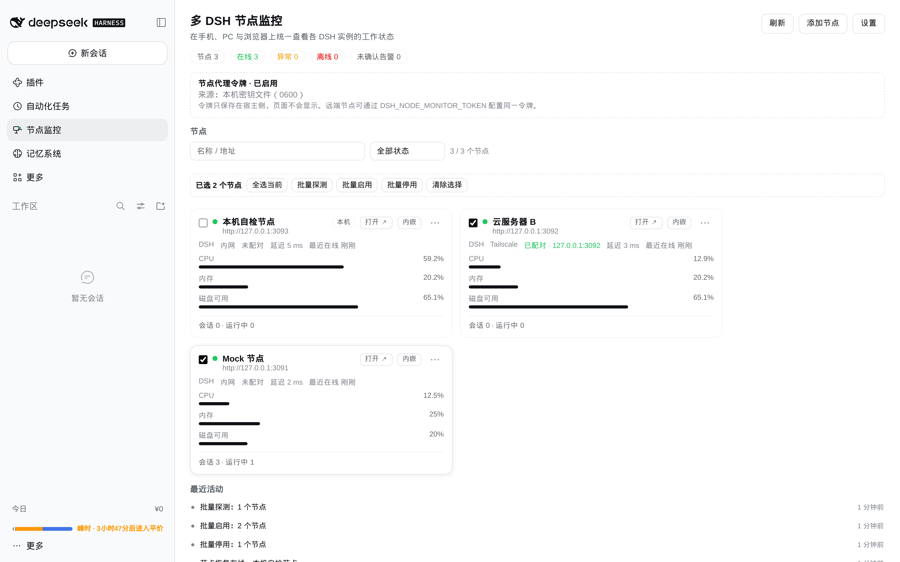


## 已验证（2026-11-12，实机）

| 项目 | 结果 |
| --- | --- |
| 自动化测试 | `npm test` → **38/38** 通过（27 单测 + 11 集成，含真实 `node:http` 往返、加载安全、登录材料/一次性票据、控制面 dry-run/confirm/审计、批量操作、局域网发现报文与令牌轮换用例） |
| 安装 | `plugin_manager install_bundle` → `applied`，profile 增加 link 依赖与 bundle 条目 |
| 节点端点 | `GET /node-monitor/api/v1/health` → `200 {"ok":true,"protocol":"dsh.node-monitor/1","name":"dsh-node-monitor"}`；`/status` 无 Bearer → `401` |
| 落盘权限 | `~/.dsh/node-monitor/secrets.json`、`state.json` 均为 `0600`，`state.json` 内不含任何令牌 |
| 左侧栏 | 主 GUI（:3081）与隔离实例（:3099）均出现「节点监控」入口，点击选中主面板 |
| 总览 | 自检节点在线、CPU/内存/磁盘/会话指标、事件流正常刷新 |
| 跨实例多节点 | 另起一个独立 DSH 实例（:3098，独立 `DSH_HOME`），用其 `secrets.json` 的 agent 令牌在面板中添加为第二节点 → `节点 2 / 在线 2`，两节点各自上报 CPU/内存/磁盘/延迟，事件流与详情页均正确 |
| H1 会话概览 | mock 节点返回 3 个会话（running/idle/子会话）+ 对话正文字段 → 面板只显示 ID/状态/模型/目录/时间，`messages` 未泄漏（`LEAK=false`），0 console error |
| H2 同源内嵌 | Hub(:3093) 与节点(:3092) 同站：iframe 经一次性票据 302 进入节点真实 DSH（`FRAME_HAS_NEW_SESSION=true`），0 console error；跨站降级为新标签页 |
| H3 运维控制 | 节点开启 `allowControl` 后 `/status.control` 返回 4 个动作；面板列出 60 个可管理插件、行内确认 1 条；dry-run 不落变更、审计写入 `audit.jsonl`（0600） |
| H4 筛选/告警 | 搜索「云服务器」→ `1 / 3 个节点`；分组标签显示在卡片；未确认告警行可直达节点详情 |
| H4 批量操作 | 勾选 2 个节点 → 批量栏显示「已选 2 个节点」；批量停用/启用后卡片 `enabled` 落盘、停用节点不再探测；批量探测逐个刷新并写事件；0 console error |
| 告警闭环 | 添加离线节点 → 约 10s 后 `节点离线` 告警与离线统计 → `确认` 后未确认告警归零 → 移除节点恢复 |
| 弹窗/表单 | 添加节点（DSH / 通用 HTTP、健康检查路径、令牌、标签、测试连接）、设置、移除确认全部可用 |
| 移动端 | 390×844 单列布局，卡片与弹窗自适应 |
| Hub 免登录打开（v0.2.0） | 两台独立实例（:3093 Hub、:3092 节点）：给节点配对登录材料后点「打开」→ 一次性票据经 `/node-monitor/open` 302 到节点登录地址 → 新标签页进入远端实例自己的 DSH 界面（标题 `DeepSeek Harness`，侧栏含该节点的「节点监控」入口），Hub 控制台 0 error |
| 登录材料安全 | 面板只显示「已配对 · host」；`state.json` 无明文；`secrets.json` 0600 保存；票据 60s 过期、nonce 一次性、重放/篡改返回 403 |
| 旧宿主降级（v0.2.0） | 宿主半未重载时（主实例 :3081，v0.1.x）刷新新客户端 | 卡片显示「内网 / 未配对」；「打开」退化为直接打开节点地址；编辑弹窗提示重启 DSH；控制台 0 error |
| 浏览器控制台 | 整个流程 0 error（`docs/console-errors.json` 为 `[]`） |

截图见 `docs/screenshots/`，采集脚本（Playwright）与验证环境说明见 `DESIGN.md` §8.5。

## 安装（推荐：本机 profile）

```bash
# 在 DSH 宿主上执行（插件目录就是本包目录）
dsh plugin add /root/dsh_workspace/dsh-node-monitor
```

或在 DSH Web GUI 的插件市场/插件管理中使用「安装本地 bundle」，目标填本目录的绝对路径：

```text
/root/dsh_workspace/dsh-node-monitor
```

安装会把本包注册为 profile bundle（`package.json` 的 `dsh.profile.bundles`，依赖写成 `link:<本目录>`），插件行由本包自带的 `dsh.bundle.patch`（`cordis.patch.yml`）在加载时组合，**不需要手工改 profile 文件**。随后刷新页面即可在左侧栏看到「节点监控」图标。

> 实机提示：安装会触发 profile 重建。若日志出现 `listen EADDRINUSE` / `HMR is disposed`，说明宿主端口被占用、热更新未能接管，属宿主侧现象；插件本身仍可能已生效（先访问 `/node-monitor/api/v1/health` 确认）。必要时重启一次 `dsh web`。

更新：重新执行 `dsh plugin add <目录>`（或在插件管理中升级），HMR 会重建插件的宿主与浏览器两半。**v0.2.0 新增的 Hub 能力在宿主半（`openTicket`/登录材料存储），需要在宿主重启后生效**；浏览器半刷新页面即生效，旧宿主下「打开」会自动退化为直接打开节点地址。

## 加载安全与故障隔离（v0.1.1）

插件加载阶段（安装、升级、宿主热重载）曾经可能拖住宿主：`apply()` 里等待 `connection`/`webServer` 服务就绪最长 8 秒，重载窗口内会让插件激活看起来像卡死，进而表现为整站无响应。v0.1.1 起改为：

| 机制 | 行为 |
| --- | --- |
| 非阻塞激活 | `apply()` 立即返回 disposer，初始化在后台执行；任何一步失败只记日志并降级，不向 Loader 抛错 |
| 短窗口挂载 | Web 集成最多等待 1.5 秒；服务未就绪则后台补挂，面板轮询会自动重试 |
| 重复注册重试 | RPC 通道/路由被上一实例占用时做 5 次×400ms 重试，而不是抛异常 |
| 面板错误边界 | 浏览器侧用 `PanelBoundary` 包住整个面板；渲染异常只降级为面板内提示 + 刷新按钮，不冒泡到宿主 UI |
| 一键停用 | 配置 `enabled: false` 或环境变量 `DSH_NODE_MONITOR_DISABLE=1`，插件完全不注册任何东西 |

如果怀疑插件与宿主异常有关，按下面顺序处理：

1. **先停用**：在 profile 的插件配置里给本插件加 `config: { enabled: false }`，或启动宿主前设 `DSH_NODE_MONITOR_DISABLE=1`，然后重启 `dsh web`；
2. 确认问题消失后，再检查 `[node-monitor]` 前缀的宿主日志与浏览器控制台；
3. 需要彻底移除时执行 `dsh plugin remove dsh-node-monitor`（或在插件管理中卸载）。

> 说明：插件只注册两条只读 HTTP 路由、一个已认证 RPC 通道、一个 600ms 后启动的采集定时器；不在加载期写业务数据。安装后首次刷新页面若仍短暂断开，属于宿主重载期间的正常重连。

## 快速开始

1. 打开左侧栏「节点监控」。首次打开会自动接入一个「本机自检节点」，它用真实的 HTTP 探测链路验证整条监控通路。
2. 在**其它 DSH 节点**同样安装本插件。
3. 为这些节点配置同一个 agent 令牌（二选一）：
   - 环境变量（推荐容器/云主机）：`DSH_NODE_MONITOR_TOKEN=<48位十六进制>`
   - 或拷贝本机 `~/.dsh/node-monitor/secrets.json` 里的 `agentToken` 到远端的同名文件（`0600`）
4. 回到面板 → 「添加节点」：填名称与地址（如 `https://node2.example.com`，不要带查询串/账号密码），适配器选「DSH」，粘贴令牌，点「测试连接」确认后保存。
5. 令牌轮换：更新远端环境变量/密钥文件后，在面板编辑该节点并填入新令牌即可。

## 多机集中管控 Hub（v0.4.0）

v0.2.0 起，本插件除了「看状态」，还可以作为多机入口：**不在 Hub 里重写聊天**，而是把每台节点的真实 DSH 界面直接打开。这样会话、任务、工具全部走节点自己的 DSH，Hub 只负责入口与状态，协议零维护。

### 1. 给节点配对登录材料

1. 在节点上启动 DSH，复制启动打印的地址（形如 `http://<host>:3080/?token=…`；反向代理后是 `https://node.example.com/?token=…`）；
2. 在 Hub 面板里编辑该节点 → 「登录材料」粘贴这条地址 → 「保存登录材料」；
3. 面板只显示 `已配对 · <host>`，地址与 token 只写入 Hub 宿主的 `~/.dsh/node-monitor/secrets.json`（0600），**不会**回显、不会写日志、不会进 `state.json`。

### 2. 一键打开

点节点卡片或详情页的「打开」：面板先向宿主申请一次性票据（60 秒、nonce 只用一次、HMAC 签名），浏览器打开 `/node-monitor/open?id=…&t=…`，宿主校验通过后 `302` 到该节点登录地址，新标签页即为**该节点自己的 DSH 界面**。

- 未配对登录材料时，「打开」直接落到节点地址，可手动粘贴令牌；
- 宿主还没重载到 v0.2.0 时（旧版本仍在内存里），面板会自动退化为直接打开节点地址，并提示重启 DSH；
- 登录令牌在 302 目标 URL 中，会出现在该标签页的地址栏；这是 DSH 自身的登录方式，请勿把该 URL 转发给他人。

### 3. 网络不通怎么办

节点与 Hub 不在同一网络时，优先用 **Tailscale**（或 WireGuard）组私有网，节点地址填私有网 IP/域名；也可以让节点通过 Cloudflare Tunnel 暴露一个出站域名。面板的「网络位置」字段（内网 / Tailscale / 隧道 / 公网）用于标注与筛选，不影响探测逻辑。

### 4. H1 会话概览（只读）

节点详情页新增「会话概览」：只显示会话 ID 短名、运行/空闲状态、模型、工作目录 basename、最近活动时间、父子层级，**不读取也不展示任何对话内容**（节点侧在构造 payload 时就只挑这些字段，最多 20 条，`messages/prompt/token` 一律丢弃）。Hub 侧只做展示，不新增聊天协议。

### 5. H2 同源内嵌

节点与 Hub **同站**（`new URL(node.baseUrl).hostname === location.hostname`）时，卡片/详情提供「内嵌打开」：Hub 申请一次性票据 → iframe 指向 `/node-monitor/open?...` → 302 到节点登录地址 → iframe 内即节点真实 DSH。iframe 带 `sandbox="allow-scripts allow-same-origin allow-forms allow-popups allow-modals allow-downloads"`，移动端全屏。

- 跨站（不同 hostname）不内嵌，直接提示改用新标签页：DSH 的 Cookie/启动令牌按 authority 绑定，跨站 iframe 会 401，这是安全边界而不是缺陷；
- 节点重启会轮换启动令牌，旧登录材料失效（内嵌出现 401）：重新配对登录材料即可；
- 内嵌不会复制会话数据，操作发生在节点自己的 DSH 里。

### 6. H3 运维控制（默认关闭）

节点侧默认**不开放**控制面；要在节点上显式开启（二选一）：

```yaml
# 节点 profile 的插件 config
- id: node-monitor
  name: 'dsh-node-monitor'
  config:
    allowControl: true
    allowRestart: true      # 可选，允许远程重启 DSH
```

或环境变量：`DSH_NODE_MONITOR_ALLOW_CONTROL=1`、`DSH_NODE_MONITOR_ALLOW_RESTART=1`（改完重启 DSH）。

| 动作 | 说明 | 门禁 |
| --- | --- | --- |
| `plugins.list` / `bundles.list` | 只读列举，含 `manageable/readOnly` 标记 | 开启控制即可 |
| `plugins.setEnabled` | 启用/禁用插件 | 默认 `dryRun:true` 只返回计划；真实执行需 `dryRun:false` **且** `confirm:true` |
| `restart` | 重启节点 DSH（`process.exit(0)`，由 systemd/NSSM/容器拉起） | 需 `allowRestart` **且** `confirm:true` |

- Hub 界面在详情页「运维控制」：先「加载/刷新列表」，插件行内「禁用/启用」→ 行内确认，重启按钮需二次确认；列表按 Loader 条目 `entryId` 定位，只有带 `patchId` 的条目可管理（其余标只读）；
- 每次调用（包括 dry-run、被拒绝的请求）都写入节点 `~/.dsh/node-monitor/audit.jsonl`（0600，JSONL），**绝不写入令牌**；
- 控制端点仍是节点 HTTP 服务的一部分，必须走私有网/反代 + 单用户边界；不要直接暴露公网。

### 7. H4 分组与告警联动

- 总览顶部筛选条：关键词（名称/地址）、状态（在线/异常/离线/未知）、分组（节点标签），显示「筛选结果 / 总数」并可一键清除；
- 节点卡片显示最多 2 个分组标签；告警行新增「打开节点」直达该节点详情；
- 分组即节点标签（`tags`），编辑节点时填写，适合「机房/用途/环境」这类维度；
- 批量栏（勾选卡片左上角复选框后出现）：全选当前（受筛选影响）、批量探测、批量启用、批量停用、清除选择；一次最多 64 个节点；
- 批量启停只改「是否纳入监控」：停用后该节点不再周期探测、不产生新告警（历史事件保留），再启用即恢复；批量操作与单节点操作同样要求 owner 权限。

## 全自动组网（v0.5.0）

在**两台（或更多）同一局域网的电脑**上安装本插件并重启 DSH 后，无需手工操作即可互相看到：

1. 插件会自动在 `0.0.0.0:45873` 打开一个「节点代理端口」（HTTP），因此不需要给 DSH 配 `--host`，也不会影响 DSH 原来的 3081 端口；
2. 通过 UDP 45871 广播自己的身份（只含名称/端口/版本，不含令牌），收到广播后自动向对方 `/pair` 登记并取回对方令牌，双方自动互加（标签「自动」+「双向」）；
3. Windows 首次运行如弹出防火墙提示，请勾选「专用网络」并允许，否则对端可能探测超时；
4. 自动组网默认同时开放 DSH 层「插件启停」（有审计、dry-run），如不需要可设 `DSH_NODE_MONITOR_ALLOW_CONTROL=0`；跨网络的电脑仍需先组网（Tailscale/frp 等），或手工添加节点。

## 配置

插件 Config 支持在 profile patch 中覆盖（一般不需要）：

```yaml
- id: node-monitor
  name: 'dsh-node-monitor'
  config:
    home: /root/.dsh        # 状态与密钥目录的 DSH_HOME；默认 $DSH_HOME 或 ~/.dsh
```

运行期可调参数在面板「设置」中修改（持久化在 `state.json`）：

| 参数 | 默认 | 说明 |
| --- | --- | --- |
| refreshMs | 5000 | 宿主探测周期，同时也是面板轮询上限（2000–120000） |
| timeoutMs | 4000 | 单次探测超时（800–30000） |
| offlineAfterFailures | 2 | 连续失败多少次判定离线 |
| latencyWarnMs | 1500 | 延迟告警阈值 |
| cpuWarnPct / memWarnPct | 85 / 90 | CPU / 内存告警阈值 |
| diskWarnFreePct | 10 | 磁盘可用空间告警阈值 |
| eventsLimit | 40 | 宿主保留的最近活动条数 |

## 节点侧接口

启用插件后，每个节点自动暴露：

- `GET /node-monitor/api/v1/health`：无认证的极简健康检查（`{ok, protocol, name}`）
- `GET /node-monitor/api/v1/status`：需要 `Authorization: Bearer <agentToken>`，返回协议化快照（主机、会话、指标、告警、最近活动）

`/health` 不是 DSH 的 Web 鉴权，仅用于探活；`/status` 只暴露聚合只读快照，不含任何会话内容、提示词、密钥或文件内容。

## 故障排查

| 现象 | 处理 |
| --- | --- |
| 侧栏没有图标 | 确认插件已安装且未在 profile 中禁用；查看宿主日志是否有 `[node-monitor]` 报错；刷新页面 |
| 节点显示「认证失败」 | 两端令牌不一致、远端未设置 `DSH_NODE_MONITOR_TOKEN`，或远端 agent 端点被反代拦截 |
| 节点显示「端点不存在」 | 远端未安装/未启用本插件，或地址指向了其它服务 |
| 「无法连接节点」 | 检查地址/端口/防火墙/反向代理；本插件不跟随重定向，请直接填写最终地址 |
| 面板打开空白 | 打开浏览器控制台，检索 `node-monitor` 或 `slot entry crashed`；确认客户端 bundle 已随 HMR 重建 |
| 令牌丢了 | 删除 `~/.dsh/node-monitor/secrets.json` 后重启 DSH 会生成新令牌（需同步更新所有远端与已保存节点） |

## 开发与测试

```bash
cd /root/dsh_workspace/dsh-node-monitor
npm test          # node --test：core 单元测试 + 宿主集成测试（含真实 HTTP 往返）
```

目录：

```
lib/core.js     纯逻辑（校验/探测解析/状态归并/告警/清洗/持久化），可脱离 DSH 单测
lib/index.js    宿主插件：Connection RPC、agent HTTP 端点、采集器、持久化
lib/client.js   浏览器 bundle：main 面板 + sidebar.panellist 图标
locale/         meta.title / meta.description（插件展示元数据）
test/           node --test
docs/screenshots/ 实机截图（总览/详情/表单/移动端/侧栏）
DESIGN.md       架构、接口、数据模型与验收文档
```
